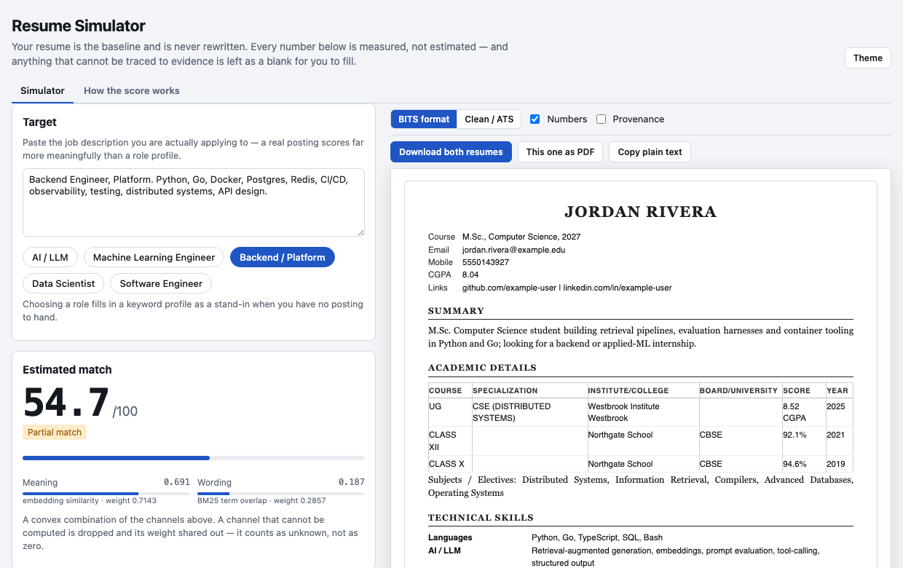
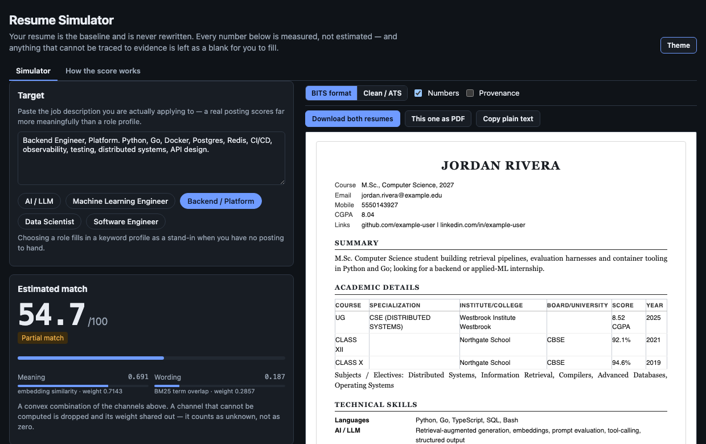
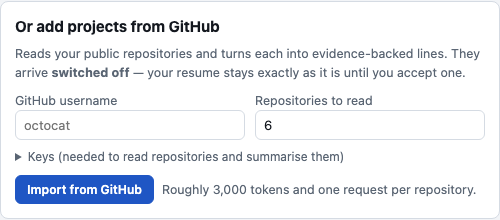

# Resume Builder Agent

Evidence-grounded resume builder. It reads a GitHub account, turns each
repository into **evidence-backed facts**, and offers them as candidate resume
lines — each showing exactly what it is worth against a real job description.

The governing rule: **the agent never invents an achievement or a number.** A
claim that cannot be traced to repository evidence is not softened or hedged —
it is dropped and replaced with a `[MEASURE: <command>]` task telling you how
to go and measure it yourself.


*v2 in motion — a resume is parsed, scored against a role profile and then
against a real posting, and unticking one line moves the headline and every
per-line delta. Recorded from the running app by
[`v2/scripts/capture_demo.py`](v2/scripts/capture_demo.py); the resume is an
invented person.*

This README covers **v2**, the current, actively-developed version — a FastAPI
service and a browser workbench over a deterministic three-channel ATS scorer,
plus a LangGraph agent that turns a GitHub account into evidence-linked resume
content.

For the full architecture — the LangGraph pipeline, the scoring math with its
citations, the claim-verification mechanism, and a complete file-by-file
reference — see **[`v2/ANALYSIS.md`](v2/ANALYSIS.md)**.

---

## What it does

- **Score a resume against a job description**, locally and deterministically:
  no credentials needed, no LLM call, bit-exact and reproducible. Three
  channels (dense embedding similarity, BM25 lexical overlap, weighted skills
  match) combined by convex combination, not an invented seven-bar rubric.
- **See a live, per-line delta.** Toggle any bullet and the headline score and
  every control updates — the number next to a checkbox is the real fused
  score recomputed server-side, not an approximation.
- **Import projects from GitHub.** A 12-node LangGraph agent reads your public
  repositories through the read-only GitHub MCP server, turns each one into
  evidence-linked claims, and verifies every number and quote against the
  actual repository content in plain Python before it ever reaches your
  resume. Unverified claims become `[MEASURE: ...]` tasks, not inventions.
  Generated lines arrive **switched off** — your uploaded resume is the
  baseline and is never rewritten.
- **See why a line is there.** The Evidence & Call-Graph tab shows every
  claim's verification status next to its quoted evidence and a real GitHub
  permalink, plus the repository's indexed functions, classes, and call edges.
- **Run the LLM side against Groq or a self-hosted Ollama model** — a `.env`
  toggle, with no code change required either way.

---

## Running it

```bash
cd v2
python3.11 -m venv .venv && source .venv/bin/activate
pip install -e ".[dev]"

# The defaults are tuned for a 1 GB container, not your laptop. On a real
# machine this is the difference between 294 ms and 84 ms per score.
RBA_ONNX_THREADS=4 RBA_EMBED_BATCH=16 uvicorn rba_api.app:app --port 8000
```

Or in Docker, which bakes the embedding model into the image so the container
never needs the network to score:

```bash
cd v2
docker compose up --build
# open http://localhost:8000
```

**No credentials are needed to upload a resume and score it** — that path is
local and deterministic, and `.env` is optional. You only need keys for the
GitHub import (`GROQ_API_KEY` or an Ollama endpoint, plus
`GITHUB_PERSONAL_ACCESS_TOKEN`).

Full setup, configuration, the API surface, and the test suite:
[`v2/README.md`](v2/README.md).

---

## Repository layout

```
.
├── README.md                this file
├── .github/workflows/       CI: secret scan + v2 tests
├── scripts/                 repo-level tooling (secret scan)
└── v2/
    ├── ANALYSIS.md          architecture, scoring design, file-by-file reference
    ├── README.md             setup, configuration, API, tests
    ├── trace.md              the running, measured change log behind every fix
    ├── src/rba/              the engine
    ├── src/rba_api/          FastAPI layer
    ├── web/                  the browser workbench (no build step)
    └── tests/
```

## What it looks like

| | |
|---|---|
|  |  |

The paper preview stays white in both themes on purpose: it is a preview of
something that gets printed and emailed.



Imported lines arrive **switched off**, each showing the measured gain if you
accept it. Your resume is the baseline and is never rewritten.

## Tests

```bash
cd v2 && python -m pytest     # 540 tests, offline, no credentials needed
```

Runs fully offline against fakes, with dummy credentials. If a test needs a
real credential, that test is wrong.

## Where the design comes from

The scoring method is not invented here —
[`docs/literature-survey.md`](docs/literature-survey.md) covers the whole
pipeline (parsing, matching, generation, evaluation) with section-level
citations, an inventory of what this project implements, and an honest list of
what it does not.
