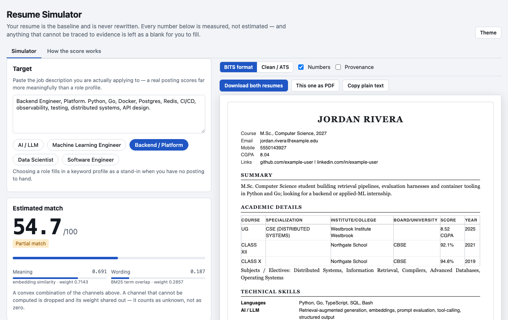
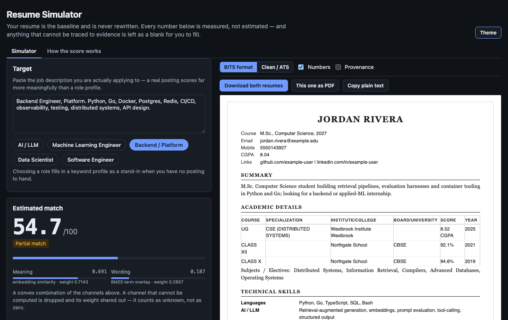
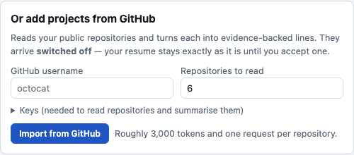

# Resume Builder Agent

Evidence-grounded resume builder. It reads a GitHub account, turns each
repository into **evidence-backed facts**, and offers them as candidate resume
lines — each showing exactly what it is worth against a real job description.

The governing rule: **the agent never invents an achievement or a number.** A
claim that cannot be traced to repository evidence is not softened or hedged —
it is dropped and replaced with a `[MEASURE: <command>]` task telling you how
to go and measure it yourself.


*v2 in motion — a resume is parsed, scored against a role profile and then
against a real posting, and unticking one line moves the headline and every
per-line delta. Recorded from the running app by
[`v2/scripts/capture_demo.py`](v2/scripts/capture_demo.py); the resume is an
invented person.*

This repository holds **two versions of the same product.**

```
.
├── v1/   Streamlit app  — shipped, deployed, feature-complete
└── v2/   FastAPI + web  — in progress, the same engine behind a real UI
```

---

## Which one should I use?

| | **v1** | **v2** |
|---|---|---|
| Status | **Shipped and stable** | **In progress** |
| Interface | Streamlit | FastAPI + a static HTML/CSS/JS workbench |
| How you run it | `streamlit run app.py` | `docker compose up` |
| Deployed at | [Streamlit Community Cloud](https://aniketqw-resumebuilder.streamlit.app) | self-hosted |
| Docker | CLI only (`ENTRYPOINT ["rba"]`, no server) | the whole app, one `compose up` |
| Scoring engine | fused dense + BM25 + skills | **the same engine** |
| Use it if | you want the working tool today | you are developing the new UI |

**If you just want to score a resume, use v1.** v2 is where the interface is
being rebuilt; it will replace v1 when it reaches parity.

---

## What is actually different

Both versions share the same `src/rba` engine — the ONNX embedding model, the
BM25 channel, the skills matcher, claim verification, the PDF/LaTeX renderers.
**v2 does not reimplement scoring, and that is the point.** Everything below is
about the layer above it.

### 1. v2 has an HTTP API; v1 has none

v1's Streamlit page calls Python functions directly in-process. There is no API
and nothing else can drive it. v2 puts a FastAPI layer (`v2/src/rba_api/`) in
front of the same functions, so the browser, `curl`, and tests all go through
one documented surface.

### 2. v2 is genuinely dockerized

v1's `Dockerfile` builds the **command-line tool** — no port, no server, no web
UI. "Docker" in v1 means `docker compose run --rm rba doctor`. v2 ships a
multi-stage image that serves the actual application on port 8000, runs as a
non-root user, pre-bakes the embedding model into the image so first use is not
a 128 MB download, and has a healthcheck that fails if the dense scoring channel
did not load.

### 3. v2's UI can do things Streamlit structurally cannot

A sticky two-pane workbench, a live paper preview of the resume in both the BITS
and clean layouts, segmented per-item controls where every option shows its own
measured score delta, and a role/pathway simulator. Streamlit's execution model
reruns the script on every interaction, which is why v1's UI is a vertical form
and not a workbench.

### 4. v2 shows where the score comes from, not a different score

v2 keeps the shape of a familiar scorecard but **re-sources every number**. In
particular it does **not** show a seven-bar rubric summing to 100. Those weights
were invented — nobody measured that a missing phone number is worth exactly six
points — and `v1/src/rba/resume/diagnostics.py` already says so in its own
docstring. v2 shows the three real channels (dense 0.5 / lexical 0.2 /
skills 0.3) and uses the rubric only for *advice*: which keyword is missing,
whether the resume is too long. Advice does not need a weight to be worth reading.

Two further rules v2 holds itself to:

- **The browser never computes a score.** It renders numbers the server sent.
  The obvious client-side shortcut — approximating a document's embedding by
  pooling its bullets' — was measured in `attribution.py` and agreed on *sign*
  for only 14 of 20 bullets. A number that is wrong about its own direction is
  worse than no number, so pending cells show a dim `·` and wait.
- **Improvement steps state a measured gain, never an estimated one.** v1
  derived a plan step's gain from keyword arithmetic. v2 applies the step and
  actually rescores the resulting document.

### 5. v2 asks before it grounds against the wrong repository

v2 adds a blocking confirmation step after a GitHub import, where you confirm
which repository each project maps to. `matching.py` explains why this matters:
grounding a project against the wrong repository verifies real claims against
unrelated evidence — stripping true statements and keeping false ones.

---

## Running v1

```bash
cd v1
python3.11 -m venv .venv && source .venv/bin/activate
pip install -e ".[dev]"
cp .env.sample .env     # fill in the four keys
rba doctor              # verifies every credential and provider
streamlit run app.py
```

Full detail, including credentials and how the agent works: [`v1/README.md`](v1/README.md).

## Running v2

```bash
cd v2
python3.11 -m venv .venv && source .venv/bin/activate
pip install -e ".[dev]"

# The defaults are tuned for a 1 GB container, not your laptop. On a real
# machine this is the difference between 294 ms and 84 ms per score.
RBA_ONNX_THREADS=4 RBA_EMBED_BATCH=16 uvicorn rba_api.app:app --port 8000
```

Or in Docker, which bakes the embedding model into the image so the container
never needs the network to score:

```bash
cd v2
docker compose up --build
# open http://localhost:8000
```

**No credentials are needed to upload a resume and score it** — that path is
local and deterministic, and `.env` is optional. You only need keys for the
GitHub import.

Use a **separate virtualenv** from v1: both packages install a console script
called `rba`, so sharing one environment means whichever was installed last
wins.

v2 defaults to GitHub's hosted MCP endpoint and does **not** mount your Docker
socket. The self-hosted path is opt-in and explained, with its trade-off, in
[`v2/README.md`](v2/README.md).

---

## Repository layout

```
.
├── README.md                this file
├── .github/workflows/       CI runs both versions independently
├── v1/
│   ├── app.py               the entire Streamlit UI
│   ├── src/rba/             the engine
│   ├── tests/               offline suite
│   ├── evals/  scripts/  space/
│   └── README.md            v1's full documentation
└── v2/
    ├── src/rba/             the engine (v2's own copy, free to evolve)
    ├── src/rba_api/         FastAPI layer
    ├── web/                 the browser workbench (no build step)
    ├── tests/
    └── README.md            v2's full documentation
```

v2 carries its **own copy** of the engine rather than importing v1's, so each
version builds, tests and ships without reference to the other. The trade-off is
deliberate: an engine fix has to be applied in both places, and the exactness
tests in `v2/tests/` exist to catch v2 drifting away from v1's numbers.

## What v2 looks like

| | |
|---|---|
|  |  |

The paper preview stays white in both themes on purpose: it is a preview of
something that gets printed and emailed.



Imported lines arrive **switched off**, each showing the measured gain if you
accept it. Your resume is the baseline and is never rewritten.

## Tests

```bash
cd v1 && python -m pytest     # 495 tests, offline
cd v2 && python -m pytest     # 540 tests, offline
```

Both suites run fully offline against fakes, with dummy credentials. If a test
needs a real credential, that test is wrong.
