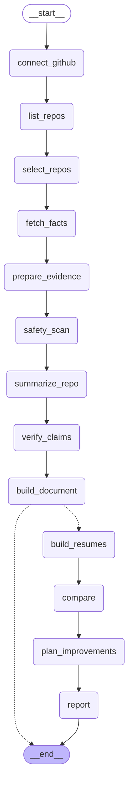

# Resume Builder Agent (v2) — Architecture & Interview-Prep Notes

One-paragraph pitch: **an evidence-grounded resume builder.** You upload a
resume (or paste one) and a job description; a deterministic, three-channel       
scorer gives you one honest match score with a live delta on every bullet
you toggle. Optionally, you point it at a GitHub account; a 12-node
LangGraph agent reads your public repos through the read-only GitHub MCP
server, turns each one into evidence-linked claims, verifies every number
and quote against the actual repo content in plain Python (not a prompt),
and drops anything it can't prove into a measurement task instead of
inventing it. Nothing the agent writes reaches you unverified, and nothing
on the resume-scoring side is computed in the browser — every number comes
from the server so a "delta" next to a checkbox is a real, reproducible
fused score, not an approximation.

---

## 1. The two halves of the system, and why they're separate

**Half A — the ATS scorer** (`rba/ats/`, `rba/resume/`). Pure, deterministic,
zero LLM calls. Takes a resume document + a job description and produces a
score. This is what runs every time you toggle a bullet — it has to be fast
(sub-millisecond-to-tens-of-ms with a warm cache) and **bit-exact**: the
whole UI's premise is that the number shown beside a checkbox is the real
fused score, not an estimate, so if two code paths could disagree by a
rounding step the entire feature would be a lie.

**Half B — the GitHub-import agent** (`rba/graph.py`, `rba/nodes/`). An LLM
pipeline (Groq or self-hosted Ollama) that turns a GitHub account into
resume content. This is the one place the system spends LLM tokens, and the
one place where "the model said so" is never trusted on its own — every
claim it produces gets checked against real evidence by plain Python before
it's allowed onto the resume.

They share one thing: `ResumeDoc` (`rba/resume/document.py`), the editable
document model both halves operate on. The agent *adds* candidate bullets,
switched off by default; the scorer only ever sees whatever bullets are
currently enabled.

---

## 2. The LangGraph pipeline (Half B) — one graph, two entry points

**Why one graph, not two.** The CLI needs a full report (role-fit
comparison, an improvement plan); the browser just needs an editable
resume document, fast. These used to be two hand-sequenced pipelines. Now
there is one `StateGraph` with twelve nodes, and exactly one conditional
edge (`_after_document`): the CLI sets `full_run=True` in its input state
and gets the extra four nodes; the browser omits it and the graph ends at
`build_document`. Measured reason this mattered: a full CLI run took
1,433s, of which 642s + 616s was pure rate-limit backoff from the seven
extra Groq calls (per-role resumes, comparison table, improvement plan) —
calls a browser import never needed in the first place. Stopping early
*is* the fix; no second workflow was built.

**The 12 nodes, in order:**

| # | Node | What it does | LLM call? |
|---|---|---|---|
| 1 | `connect_github` | Builds the GitHub backend (MCP or REST) and the LLM client (Groq or Ollama, see §6) | no |
| 2 | `list_repos` | Lists public repos for the username | no |
| 3 | `select_repos` | Hard rules (drop forks/archived/empty/low-commit) + Jev scoring of what's left, picking which repos are worth summarizing and at which Groq tier | Jev only (not Groq) |
| 4 | `fetch_facts` | Deterministic fact-gathering per repo: README, tree, commits, key manifest files, ranked source files — concurrent across repos (`asyncio.gather` + a semaphore) | no |
| 5 | `prepare_evidence` | Builds a `RepoBrain` (stdlib-`ast` code-structure index: functions, classes, call edges, route registrations) from the fetched source files | no |
| 6 | `safety_scan` | Scans fetched content for anything that looks like a secret before it ever reaches a prompt | no |
| 7 | `summarize_repo` | The one node that spends real model tokens: turns a repo's evidence bundle into a one-line summary + a handful of claims, each with a quoted evidence excerpt | **yes** |
| 8 | `verify_claims` | Plain-Python verification — see §4. Never trusts the model's own claim that something is true | no |
| 9 | `build_document` | **The CLI/browser join point.** Builds the editable `ResumeDoc` from verified summaries. Browser import stops here. | no |
| 10 | `build_resumes` | CLI-only: per-role-profile resume generation | yes |
| 11 | `compare` | CLI-only: a hand-written rubric comparison table (explicitly **not** the ATS score — see §4's honesty note) | no |
| 12 | `plan_improvements` | CLI-only: an improvement plan with `[MEASURE: ...]` tasks for anything unverified | yes |

**The actual compiled graph**, exported directly from `build_graph(Runner(...))`
by `scripts/export_graph.py` — not hand-drawn, so it can't drift out of sync
with `graph.py`. The dotted edges are the one conditional branch
(`_after_document`): the browser import stops at `build_document` and goes
straight to `__end__`; only a CLI run (`full_run=True`) continues into
`build_resumes`.


<details>
<summary>Mermaid source (renders natively if GitHub's image cache is
unavailable, or if you want to edit/regenerate it)</summary>



</details>

*Regenerate both with `.venv/bin/python scripts/export_graph.py` after any
change to `graph.py` — it writes `docs/v2-graph.mmd` and
`docs/v2-graph.png` via LangGraph's own `draw_mermaid`/`draw_mermaid_png`.*

**Why this node ordering specifically:** Groq cannot combine tool use with
structured JSON output in one request. So every node that touches GitHub's
MCP tools (`fetch_facts`) is strictly separated from every node that asks
for strict JSON (`summarize_repo`, `build_resumes`, `plan_improvements`).

**No checkpointer, no human-review interrupt.** Both were judged more than
this project needs. Dropping the checkpointer also drops the requirement
that `AgentState` be msgpack-serializable, which is what lets it carry a
`RepoBrain` (plain dataclasses) and a `ResumeDoc` through state directly.

---

## 3. Evidence and verification — the honesty mechanism (Half B)

This is the single most interview-relevant design decision in the project,
because it's the answer to "how do you stop an LLM agent from making stuff
up on a resume."

- **`nodes/summarize.py`** builds a compact, bounded evidence bundle per
  repo (README excerpt, file tree, recent commit messages, dependencies,
  code structure from `RepoBrain`) — capped at ~7,000 chars (~2k tokens),
  well under Groq's 8,000 TPM budget. The model is asked for a one-line
  summary plus **at most 6 claims**, each with a quoted excerpt copied
  *exactly* from the bundle it was shown.
- **`nodes/verify.py`** is the enforcement, in plain Python, not a second
  prompt asking the model to "double check itself":
  - Every **numeric token** in a claim must appear verbatim in the
    evidence. "Reduced latency by 40%" with no "40" anywhere in the
    evidence → rejected, converted into a `[MEASURE: ...]` task instead of
    silently dropped.
  - **Technologies** are checked against the summary's own declared `tech`
    list, not scanned out of free-text prose — scanning prose for
    "technology-shaped" tokens was tried and rejected 39 of 48 real claims
    in a live run on words like "fallback." and "scripts." (the trailing
    period made them look like package names).
  - **Quotes** the model attributes to the evidence must actually appear in
    it, verbatim (with light reformatting tolerance). A fabricated quote
    invalidates the whole claim.
  - A verified claim's evidence gets a **real GitHub permalink**
    (`repo/blob/<sha>/<path>#L<start>-L<end>`), built only after
    verification succeeds — a `needs_measure` claim gets no permalink at
    all rather than a fabricated-looking one (a real bug found and fixed
    earlier: `from_summaries()` used to build a permalink for *any*
    non-rejected claim, including unverified ones).
- **Nothing is deleted.** A rejected claim becomes a measurement task
  (`[MEASURE: ...]`) in the improvement plan — "we couldn't prove this" is
  a useful, honestly-labeled output, not a silent drop.

**The "role-fit" honesty fix**: the CLI's `compare` node produces a
hand-written-rubric comparison table. It used to look like it was
reporting *the* ATS score. It is not — it's advice-only scoring against a
role profile with no real job description. This was relabeled explicitly
so the UI never conflates it with the real, deterministic ATS score from
Half A.

---

## 4. The ATS scorer (Half A) — three channels, convex fusion

**`rba/ats/fusion.py`** combines three independent similarity channels
into one score via a **convex combination** (weighted sum), not Reciprocal
Rank Fusion:

```
CHANNEL_WEIGHTS = {"dense": 0.5, "lexical": 0.2, "skills": 0.3}
```

**Why convex combination, with a citation**: Bruch et al., *An Analysis of
Fusion Functions for Hybrid Retrieval* (arXiv 2210.11934, TOIS) tested RRF
(k=60, the usual default) against a simple weighted sum and found the
weighted sum won on every dataset tried (nDCG@1000: 0.454 vs 0.425 on MS
MARCO, 0.542 vs 0.514 on Natural Questions). RRF's tuned parameters were
also shown not to generalize out-of-domain — exactly this project's
situation (no in-domain resume/JD-matching data to tune RRF's k on).
Normalization is by **theoretical bounds**, not observed min-max, for the
same reason (survives distribution shift, and observed min-max is
undefined for a single candidate — min == max).

**The three channels:**
1. **Dense** — semantic similarity via `BAAI/bge-small-en-v1.5` (MIT, 33M
   params, 384-dim), run through **ONNX Runtime, not
   sentence-transformers** — sentence-transformers pulls PyTorch (~1GB
   installed, 400-700MB resident); ONNX Runtime + this model is ~150MB
   resident, which matters for a memory-constrained deployment (Streamlit
   Community Cloud's 690MB guarantee, from v1). Chosen over
   `all-MiniLM-L6-v2` specifically because MiniLM's retrieval BEIR score
   (43.81) is well below bge-small's (51.68), and MiniLM silently
   truncates at 256 tokens — bad for a document as long as a resume. The
   channel **degrades rather than fails**: if the model can't load, `embed()`
   returns `None`, the channel drops out, and its weight is redistributed
   across the other two (never silently treated as a zero score).
2. **Lexical** — BM25 term overlap (`rank-bm25`).
3. **Skills** — weighted keyword/skill matching.

**The 512-token problem and its fix (chunking).** `bge-small` genuinely
handles 512 tokens; a real one-page resume is ~1,150 as plain text — more
than half was invisible to the dense channel. Fixed by chunking the
document along its own section/entry boundaries (`resume/chunking.py`),
embedding each chunk, and mean-pooling the vectors into one (length-
weighted, renormalized) — established practice for long-document
sentence-embedding matching (sentence-BERT chunk-averaging). The more
advanced alternative, Jina AI's "late chunking" (2024), needs a
long-context encoder to embed the whole document *before* splitting,
which `bge-small` can't do without reopening the memory-footprint tradeoff
above — so it wasn't used.

**A real determinism bug this surfaced, and its fix.** The same chunk
embedded in a batch alongside *different* other candidates produced a
reproducible ~4.3e-08 vector-level difference (floating-point
batch-padding artifact of `encode_batch`'s dynamic padding-to-longest-in-
batch — not randomness, identical across 10 trials). This silently broke
exact equality between "a document scored alone" and "the same document
scored as the base of a leave-one-out sweep." Fixed in
`ats/batch.py::_dense_values`: the **first** chunked candidate (always
"the document as it stands") is embedded in its own dedicated call,
separate from the rest of the batch — making the base score bit-exact
regardless of how many variants are swept alongside it. A fixed-length-
padding alternative was measured and rejected (76.9x slower: 9ms → 701ms
for two short chunks).

**Why batching matters at all (`ats/batch.py`).** A full simulator view
shows ~145 live score deltas (every toggle, every version button, every
improvement step). At one `rescore` each (290ms warm, measured) that's 70
seconds — unusable. Four exact levers fix it, with zero approximation: (1)
**truncation dedup** — candidates differing only past the 512-token cut
have bit-identical embeddings, so they're deduplicated before embedding
(measured: 16 variants → 4 forward passes on the attribution path); (2)
**one batched embed call** for the remaining unique texts; (3) **a dense
memo/cache** so toggling a line off and back on reuses a cached embedding;
(4) **per-bullet leave-one-out attribution** (`resume/attribution.py`)
computes the exact delta of disabling any one line.

**The "browser never computes a score" rule.** Every number in the UI
comes from the server. The obvious client-side shortcut — approximating a
document's embedding by pooling its already-computed bullet embeddings —
was tried and measured: it agreed on *sign* for only 14 of 20 bullets
(i.e., it would tell a user a line helps when it actually hurts). A delta
that hasn't been computed server-side renders as a dim `·`, not a guess.

---

## 5. The GitHub backend — MCP, with a REST fallback

**`rba/github_tools.py`** abstracts two backends behind one interface:
- **`McpBackend`** (default): talks to GitHub's **hosted, read-only** MCP
  endpoint (`/mcp/x/repos/readonly`), not the plain `/mcp/` endpoint — the
  plain one exposes write tools (`delete_file`, `push_files`,
  `create_repository`); the read-only path returns 13 tools and *zero*
  write tools, verified by enumerating both live. The agent refuses to
  start if a write tool ever shows up. `langchain.mcp`'s default
  `handle_tool_error` silently converts a server-reported failure
  (`isError=True`) into normal-looking text content — disabled explicitly
  (`tool.handle_tool_error = False`) after a live bug where a bad commit
  ref's error message ("failed to resolve git reference") was stored and
  parsed *as if it were file content*, producing a spurious syntax error.
- **`RestBackend`**: a dependency-free fallback over the plain GitHub REST
  API, for anyone who can't/won't run the MCP path.
- Every file fetch is **pinned to the exact commit SHA** the run observed
  when listing commits — not the branch name — so a push between "list the
  tree" and "read the file" can't silently desync a permalink from the
  content it claims to point at. (SHAs are never truncated for this reason
  either — an earlier bug truncated them to 10 chars for display, then
  reused the truncated value as the fetch `ref`, which GitHub's hosted MCP
  server can't resolve.)
- Retries classify errors as permanent vs transient (`_is_permanent_error`)
  so a guaranteed-to-fail request doesn't burn the full exponential-backoff
  budget before giving up.

**`rba/repobrain.py`** — the "repo brain": a stdlib-`ast`-only code-
structure adapter (symbols, call edges, route bindings), built specifically
because **CodeGraphContext** (Neo4j + tree-sitter) was evaluated and
rejected: it forces `protobuf==3.20.3`, which breaks the `onnxruntime`
version the dense scorer needs. Scope is honestly stated in its own
docstring: Python only, bare-name call resolution (no import resolution,
so two same-named functions in different files aren't disambiguated) —
every file that couldn't be indexed is recorded in `partial_source`, never
silently dropped.

---

## 6. Two LLM providers — Groq (default) and Ollama (opt-in)

**Why two.** Groq's free tier caps summarization at 8,000 tokens/minute —
a real, repeatedly measured bottleneck. `OLLAMA_CLIENT` / `LLM_PROVIDER` in
`.env` lets the same pipeline run against a self-hosted model instead, with
no rate limit at all.

**`rba/groq_client.py`**: tier routing (`small`/`mid`/`big` → model IDs in
`config.yaml`), a token-bucket rate limiter (`rba/limiter.py`), strict JSON
schema mode for `STRICT_CAPABLE` models (the `openai/gpt-oss-*` family),
response caching keyed by (repo, sha, prompt, model) so re-running an
import doesn't re-spend tokens on unchanged content, and LangSmith tracing
wired as a child run under the active graph-node span.

Two non-obvious failure modes it specifically guards against:
- **The reasoning trap**: `gpt-oss` models spend the completion budget on
  an internal `reasoning` field and return `content == ""` with a small
  `max_tokens` — a 200 OK that looks like silence. Fixed with a forced
  `reasoning_effort: low` and a `max_tokens` floor.
- **Schema-mismatch 400s**: Groq's own strict-schema enforcement can
  reject a generation for being the *wrong shape* (not out of room) —
  previously retried identically to a truncation (doubling `max_tokens`,
  which does nothing for a shape error) for up to 5 attempts before
  failing. Fixed with a distinguishable `SchemaRejectedError`, caught by
  `structured()`'s existing corrective-retry loop (the same repair used
  for a client-side Pydantic `ValidationError`): the model is shown its
  own bad generation and asked to fix it, once.

**`rba/ollama_client.py`**: a structural twin of `GroqClient.structured()`
— same `(messages, schema, ...) -> (T, Usage)` signature, so nothing in
`nodes/summarize.py`/`build.py`/`plan.py` had to change; only
`graph.py`'s `Runner.connect()` branches on `LLM_PROVIDER` to pick which
client to build. Posts to `/api/chat` with `format` set to the schema's
**full JSON Schema** (not just `"json"` mode) — verified live against a
real host that this produces strictly schema-conforming output. No rate
limiter (the entire point). Currently configured model:
`qwen2.5:14b-instruct` (Q4_K_M quantization), chosen for reliable
instruction-following at a size that leaves room for other users on a
shared GPU host. Smoke-tested: clean, correctly-shaped JSON on the first
attempt, where Groq's small tier needed the corrective retry and still
failed outright for some repos.

---

## 7. The FastAPI layer

- **One process, one worker, deliberately** (`rba_api/app.py`): the
  session store, the ONNX `InferenceSession`, the dense embedding cache,
  the rate limiters, and several `lru_cache`s all live in process memory.
  A second worker would duplicate the model, halve cache hit rates, and —
  worst — give each worker its own rate limiter, so the real Groq budget
  would be exceeded by exactly the worker count.
- **`AppState` (`deps.py`)**: process-wide singletons — a `Limiter` keyed
  per effective API key (so two imports sharing a key share one limiter,
  not one each), one shared SQLite `Cache` connection, the thread pools,
  the embedding model (warmed at startup so the first real request doesn't
  pay the ~1.5s cold-load cost).
- **`scoring_pool.py`**: two `ThreadPoolExecutor`s. Scoring gets **exactly
  one worker** — ONNX already parallelizes internally via
  `intra_op_num_threads`, so a second concurrent scoring batch doesn't go
  faster, it just competes for the same cores and doubles peak memory
  (risking an OOM kill with no traceback). Rendering gets two workers,
  deliberately independent of the scoring queue, so a PDF download doesn't
  wait behind someone else's batch score.
- **`sessions.py`**: the working document, held server-side between
  requests, with optimistic concurrency (`rev` + `if_match`) so two
  browser tabs editing the same session can't silently clobber each
  other. Carries a per-session `DenseCache` (a chunked, warm cache is what
  makes the chunking fix fast in real use — a cold first score measured
  ~750ms, a warm re-score measured <2ms).
- **Routes**: `meta` (scoring weights/bands/roles — the "how the score
  works" tab reads this rather than hardcoding anything), `documents`
  (upload/parse/patch), `score` (the fused score, batch scoring,
  attribution), `render` (HTML/PDF/LaTeX/plain-text/export), `github`
  (import job + SSE progress + the Evidence & Call-Graph tab's data).

---

## 8. The Evidence & Call-Graph tab

A new tab (not present in the original design) answering "why did this
line make it onto my resume": pick an imported repo, see every claim's
**status** (verified / needs-measurement / rejected — not just the ones
that survived), its quoted evidence and a real clickable GitHub permalink,
and a plain-list view of that repo's indexed functions/classes/call edges
from `RepoBrain`. Deliberately a plain list, not a force-directed graph
diagram — `repobrain.py`'s own stated scope (bare-name resolution, no
import resolution) would make a graph layout visually overclaim precision
the data doesn't have.

---

## 9. Today's bugs — a good interview story about debugging methodology

All four were found via a **real live GitHub import** and a **real
uploaded PDF**, not unit tests — the thing that makes them worth
mentioning is that each was root-caused to an exact line of code before
being fixed, and every regression test was *proven* to catch the bug by
temporarily reverting the fix and watching the test fail with the
predicted error before restoring it.

1. **Groq retried schema-mismatch 400s the wrong way** (see §6). Fixed
   with `SchemaRejectedError` + the existing corrective-retry path.
2. **Source files were truncated to 4,000 chars before AST parsing**,
   guaranteeing a `SyntaxError` on anything longer (the cut landed mid-
   token) — the project's *own* repo, fetched back from GitHub, filled
   `partial_source` with spurious errors that had nothing to do with code
   quality. Fixed: raised to a generous 60,000-char safety ceiling (not an
   expected-to-be-hit cutoff), separately from the much smaller excerpt
   cap already used for what the LLM actually sees.
3. **PDF table parsing used `pypdf`'s flat text extraction**, which
   destroys a table's column structure — the real "ACADEMIC DETAILS"
   table rendered with headers and values in the wrong cells. Fixed with
   `pdfplumber`-based geometry detection (ruled-line strategy first, a
   gap-based "text" strategy fallback), with the old heuristic kept as a
   last-resort fallback. **First pass of this fix still failed** on the
   user's real file: pdfplumber merges a section's heading line into the
   same detected table as its header row (nothing in the PDF visually
   separates them), so checking only row 0 missed the real header row.
   Fixed by searching a grid's first 3 rows for the best match.
4. **Two more parsing bugs found by re-checking the whole real document's
   render**, not just the table: an entry's title and date landed on two
   separate lines in this PDF's extraction (the old code required both on
   one line and silently dropped the title, leaving an empty-titled
   entry) — fixed with `_merge_split_dates()`. And bullets using a `\x7f`
   glyph marker with no terminal period all merged into one giant bullet
   (the old rule only recognized a trailing period as "end of bullet") —
   fixed by treating a leading bullet marker as an equally hard
   "new bullet" signal.

---

## 10. Likely interview questions, with the real answers

**"How do you stop an LLM from hallucinating on someone's resume?"**
You don't ask it nicely — you verify mechanically. Every number, quote,
and declared technology in a claim is checked in plain Python against the
exact evidence text the model was shown (§3). A claim that fails becomes a
`[MEASURE: ...]` task, not a silently dropped line and not an invented
one.

**"Why is the score deterministic/bit-exact, and why does that matter?"**
Because the UI's entire value proposition is "the number beside this
checkbox is real." If batch scoring and single-document scoring could ever
disagree by a rounding step, every delta on the page becomes untrustworthy.
This is also why the ~4.3e-08 batch-padding bug (§4) was worth fixing
properly instead of ignoring as "basically zero" — "basically zero" is not
the same claim as "exactly reproducible," and the project's test suite
enforces the stronger one (`==`, not `pytest.approx`, on the paths that
need it).

**"Why convex combination instead of something fancier like RRF?"** Cite
Bruch et al. (§4) — a simple weighted sum beat RRF on every retrieval
benchmark they tried, and RRF's tuned parameters don't generalize
out-of-domain, which is exactly this project's situation (no resume/JD
matching dataset to tune on).

**"Why ONNX Runtime instead of sentence-transformers / PyTorch?"** Memory
footprint — ~150MB resident vs ~1GB installed / 400-700MB resident — which
mattered directly for v1's Streamlit Community Cloud deployment (690MB
guarantee) and still matters for keeping the service lightweight.

**"Why MCP for GitHub instead of calling the REST API directly?"** Both
exist (`McpBackend`/`RestBackend`); MCP is the default because it's the
agent-native path, but the project verified live that the *hosted* MCP
endpoint variant matters — the plain one exposes write tools the agent
must never hold, confirmed by enumerating both.

**"How did you find [the table-parsing bug / the schema-retry bug]?"**
Not from unit tests — from a real live run, cross-checked against the
actual LangSmith trace via the SDK (`Client().list_runs(trace_id=...)`),
and in the table case, against the user's actual uploaded PDF file. Then
root-caused to a specific function/line before writing any fix, and the
regression test was proven to actually catch the bug (revert, watch it
fail, restore).

**"What happens if the dense/embedding channel fails to load?"** It
degrades, not fails — `embed()` returns `None`, that channel drops out of
the fusion, and its weight is redistributed across the surviving channels.
A `RBA_REQUIRE_DENSE=1` env flag exists for a deployment that would rather
fail loudly at startup than silently serve a half-weighted score.

**"Why one process, one worker for the API?"** Every piece of in-process
state (ONNX session, caches, rate limiters) would silently multiply per
worker — most dangerously the rate limiter, where N workers would let the
real Groq quota be exceeded by a factor of N.

**"What's the one thing you'd refactor if you had more time?"**
`groq_client.py` now carries two separate schema-failure-handling paths
(truncation-retry and shape-violation-retry) and `ingest.py` carries two
full table-parsing paths (pdfplumber-based and the older text heuristic)
side by side — both grew organically as real bugs were found, and would
benefit from being pulled apart once there's time to do it carefully
rather than under bug-fix pressure. (This is an honest, already-planned
next step, not a hypothetical — see `PLAN_PIPELINE_FIXES.md`.)

---

## 11. File-by-file reference

### `rba/ats/` — deterministic resume-vs-JD scoring

- **`calibrate.py`** — Turns a raw fused similarity (0-1) into a defensible
  number by reporting its **percentile against a stored reference set**
  ("scores higher than 63% of the reference pairs"), rather than faking a
  0-100 "ATS score" that would imply labelled-outcome calibration nobody
  has actually done (the one public person-job labelled dataset is
  Chinese, and not usable here). Stores the empirical CDF as ~100 quantile
  breakpoints for a binary-search lookup at runtime. `Calibration`,
  `build_calibration`, `save_calibration`, `load_calibration`.
- **`corpus.py`** — A small background corpus (~6 non-software job
  descriptions) purely so BM25's IDF has something to be rare against —
  with only resume+JD, every term looks equally rare and the lexical
  channel collapses. Measured: the same resume scored 0.180 with no corpus
  vs 0.476 against the background corpus, while an irrelevant resume
  stayed at 0.000. Deliberately spans non-engineering roles so "Python" is
  rare the way it's rare in the real world, not universal as it would be
  in an all-engineering sample.
- **`normalise.py`** — A curated skill-alias table ("JS"/"JavaScript"/
  "ECMAScript" → one canonical id). Explicitly **rejects ESCO** (the EU
  occupational taxonomy, ~13,900 skills) after live-querying it and
  finding it returns "no results" for Kubernetes, Docker, PyTorch,
  TensorFlow, AWS, and Terraform, plus a confidently *wrong* match for
  "react" (an emergency-response taxonomy entry) — a coverage gap
  embedding nearest-neighbor search couldn't paper over without silently
  corrupting scores.
- **`score.py`** — Public entry point (`score_resume_against_jd`,
  `ScoreReport`): pure arithmetic over the three channels, no LLM call in
  this module, so the final number is hand-recomputable and auditable.
- **`skills.py`** — The skills channel: weighted Jaccard over normalised
  skill ids (`weighted_jaccard`, `has_skills`, `SkillMatch`). Required
  skills outweigh preferred ones, mirroring Greenhouse's Required/AND vs
  Preferred/OR and Workday's basic-vs-preferred distinction — and chosen
  specifically because it's the one channel fully explainable by hand to a
  candidate who asks why they scored what they did.
- **`lexical.py`** — BM25 term overlap (`tokenize`, `idf`, `bm25_score`,
  `bm25_similarity`, `matched_terms`), which keeps literal tool/cert/
  version strings sharp where dense embeddings blur "AWS" into "cloud" —
  citing TalentCLEF 2026's finding that top systems pair dense + BM25.
  Replaces any hand-assigned keyword weight with corpus-derived IDF.
- **`fusion.py`** — See §4 above (`CHANNEL_WEIGHTS`, `convex_fuse`,
  `ordinal_band`, `theoretical_min_max`).
- **`extract.py`** — The *only* scoring step that calls an LLM, and
  strictly confined to parsing, not judgment: zero-shot resume parsing is
  ~0.96 F1 (arXiv 2510.09722), while LLM skill-extraction *judgment* is
  weak (GPT-4 27.8 vs a supervised model's 62.6 strict-span F1, arXiv
  2402.03832). `source_verify` drops any extracted skill whose quoted
  evidence isn't actually in the document — guarding against the model
  inferring Docker/CI-CD from a bare "built a REST API."
- **`dense.py`**, **`batch.py`** — see §4 above.

### `rba/` top level

- **`cache.py`** — SQLite response cache keyed by `(key, model)`; callers
  build keys from repo name + HEAD SHA + prompt version, so an unchanged
  repo costs zero tokens on re-run — material at an 8,000 TPM budget.
- **`cli.py`** — The `rba` CLI entry point: `run`, `doctor` (credential/
  network checks), `config`, plus a dry-run helper.
- **`jev_client.py`** — Client for the "Jev" TypeSafe routing API, used
  **only** for routing/selection decisions (is a repo worth resuming? which
  Groq tier should summarize it?), never for prose. Chosen because its
  output tokens are free and input is $0.042/Mtok on a *separate* quota
  from the scarce Groq budget — scoring ~100 repos costs fractions of a
  cent. Documents a real API quirk: `choice` questions need a `criteria`
  map, not a bare `options` list, or Jev returns a 422.
- **`limiter.py`** — Per-model token-bucket limiter built around the real
  binding constraint (8,000 tokens/min via `x-ratelimit-limit-tokens`, not
  the 30 req/min cap). `reserve()` estimates tokens and waits for window
  room; `reconcile()` overwrites the estimate with the real usage and
  window from the response's authoritative rate-limit headers afterward.
- **`preflight.py`** — Validates every credential once *before* a run
  spends anything. Motivated by a real incident: a Groq key typed into the
  UI silently overrode a working `.env` key, the run proceeded (serving
  some repos from cache, masking the problem), and only failed deep into
  execution with an opaque 401.
- **`report.py`** — Renders Markdown/LaTeX/PDF reports that lead with
  **provenance**, not the resume itself: which claims are proven, which
  are only "measurable" (unverified), and what the agent refused to
  assert — framing the refusal list as the most informative section.
- **`schema.py`** — Converts a Pydantic schema into Groq-strict-mode JSON
  Schema (`to_strict_schema`), fixing two things Pydantic's
  `model_json_schema()` doesn't do by default (every property must be
  `required`; every object needs `additionalProperties: false`), inlining
  `$defs` refs. `lint_strict_schema` enforces this in a unit test.
- **`scoring.py`** — The fully deterministic legacy 100-point rubric
  (keywords 44, role_fit 18, numbers 12, sections 10, contact 6, length 6,
  verbs 4). Determinism is the point: the improvement planner quotes an
  "ATS gain" per suggested step, which is only honest if rescoring the
  same resume always gives the same number.
- **`signals.py`** — Gathers cheap, deterministic, pre-LLM evidence per
  repo (README head, tree shape, recent commits — 3 REST calls, zero
  tokens), because bare repo metadata (name/size/language) is too thin to
  judge claimability on its own — a 500MB course-notes dump looks
  identical to a 500MB real project without this.
- **`state.py`** — The central `AgentState` TypedDict + domain models. Core
  concept is the **claim**: an assertion carrying its own evidence; no
  surviving evidence → `needs_measure`, never silently dropped.
  `Evidence.repo/sha/line_start/line_end` are filled in **only** by
  `verify_claims`, never the model — what makes `Evidence.permalink` a
  fact about a pinned commit, not a self-report. Uses LangGraph reducers
  (`operator.add`, a custom `_merge_dicts`) on fan-out fields (`claims`,
  `facts`, `repo_graph`, `partial_source`) so parallel node writes merge
  correctly. `repo_graph`/`document` are typed `Any` deliberately to avoid
  an import cycle with `repobrain.py`/`resume.document`.
- **`github_tools.py`** — See §5 above. Also: `_repo_items` defensively
  handles a GitHub search response that can be a bare error string, an
  error object, or the happy-path list (a past bug iterated a string
  response character-by-character). `get_tree` tries
  `get_repository_tree` (1 call, `git` toolset only), then the REST trees
  API (1 call, default), then a bounded BFS walk as a last resort — a
  naive per-directory MCP walk over ~100 repos once issued ~500 calls and
  drove the hosted endpoint into empty responses/timeouts.
- **`repobrain.py`** — See §5 above.

### `rba/resume/`

- **`diagnostics.py`** — Produces advice (missing keywords, resume too
  long, weak bullet openers, missing sections) deliberately kept **out of**
  the headline score — rejecting the reference artifact's invented
  seven-bar rubric outright ("nobody measured that a missing phone number
  is worth exactly six points"). Reuses `rba.scoring`'s detection logic
  directly so the two can never disagree on what counts as a "number" or
  a "strong verb."
- **`matching.py`** — Matches a résumé's listed projects to actual GitHub
  repos — the step that must be right *before* any claim verification, or
  true claims get verified against the wrong repo's evidence. Explicitly
  shows name-matching alone fails on real data ("Sandboxed Code-Execution
  Agent" → repo named `sandbox-agent`, no name match at all).
- **`merge.py`** — Folds GitHub-sourced bullets into the user's existing
  resume under one hard rule: **the baseline is never edited in place**;
  generated lines arrive switched off, adopted only by explicit user
  action. This is what makes "+23.0 against your uploaded resume" a real
  before/after measurement, not a claim.
- **`role_target.py`** — Synthesizes a job-description stand-in from a
  role's keyword profile when the user has no real JD (ported from v1's
  9-line fix). Returns an explicit `CAVEAT` the UI must show, plus the
  synthesized text itself so it's inspectable, never passed off as a real
  posting.
- **`selection.py`** — Represents a candidate resume variant as a small
  patch (`Op` list) rather than a full document clone — the UI asks "what
  if this line were off?" ~100 times per view, and a full `ResumeDoc` per
  candidate would bloat every batch request. `apply_ops` works on a copy,
  which is what makes concurrent scoring across requests safe.
- **`render/options.py`** — `RenderOptions`: the one dataclass defining
  everything any renderer (plain/PDF/LaTeX/HTML) is allowed to vary.
- **`render/pdf.py`** — Draws PDF directly with `fpdf2` rather than LaTeX
  or a headless browser, because the original Streamlit deployment target
  provides only a bare Python environment (no `pdflatex`; WeasyPrint needs
  system `cairo`/`pango` that aren't installable there). The layout is
  redrawn from scratch, not format-converted — output approximates but
  isn't pixel-identical to the HTML/LaTeX renderers.
- **`render/plain.py`** — Unstyled plain-text output (no tables/columns/
  glyph bullets) as the format least likely to be mangled by a parser.
  Cites a real measured number, not vendor folklore: layout-aware parsing
  lifts resume F1 from 0.919 to 0.959 (arXiv 2510.09722, Table 2) — most
  "ATS-friendly formatting" advice online is vendor guidance, not a study.
- **`document.py`, `ingest.py`, `chunking.py`, `attribution.py`,
  `pipeline.py`, `failures.py`** — see §§2, 4, and the "today's bugs"
  section (§9) above; these are the files touched most this session.

### `rba_api/`

- **`app.py`** — FastAPI app factory. See §7 (one process, one worker).
- **`deps.py`** — Process-wide singletons (`AppState`). See §7.
- **`jobs.py`** — Runs the GitHub-import pipeline (measured 1,433s for a
  full CLI run) as a background task with SSE progress, driven by a
  **synchronous** `progress(message, fraction)` callback — it must never
  block or await, since it runs inside the event-loop-bound pipeline; it
  only appends to a list and sets an `asyncio.Event` the SSE endpoint
  polls. `Update`, `Job`, `JobStore`.
- **`models.py`** — Pydantic wire-shape request/response models. Does not
  re-declare `ResumeDoc` (it already round-trips via `to_dict`/`from_dict`)
  to avoid a second schema that could drift from the canonical one.
- **`scoring_pool.py`** — See §7 (two thread pools, one scoring worker).
- **`sessions.py`** — See §7 (optimistic concurrency, per-session
  `DenseCache`).
- **`routes/documents.py`** — Session/document lifecycle: create/read/drop
  session, set scoring target, upload/parse, replace or patch the
  document.
- **`routes/render.py`** — Server-side preview/export
  (`render_html`/`pdf`/`latex`/`text`, `export_bundle`) — replacing v1's
  browser-side jsPDF+JSZip approach (CDN-dependent, broken under strict
  CSP, and the browser PDF mapped non-ASCII characters to "?"). Rendering
  server-side also guarantees the score shown beside a download and the
  bytes inside it came from the same document object.
- **`routes/score.py`, `github.py`, `meta.py`** — see §§3, 4, 7, 8 above.

### `web/js/`

- **`store.js`** — One shared state object, explicit notification. The
  document itself is **not** the client-side source of truth — it lives
  server-side; `doc` is just the last copy the server sent. The deliberate
  break from the reference artifact's localStorage-based design.
- **`dom.js`** — Tiny DOM helpers (`$`, `$$`) plus an auto-escaping `html`
  tagged template, with an explicit `raw()` escape hatch for deliberately
  unescaped nested markup.
- **`api.js`** — The one chokepoint for every server call. Enforces "the
  browser never computes a score" — there is no client-side fallback for
  a failed scoring request; a failure surfaces as a failure.
- **`render.js`** — Full-string re-render on state change (simple, fast
  enough); async results (batch deltas, a preview landing) get targeted
  text-node-only patches instead, so they don't destroy caret position or
  scroll offset.
- **`events.js`** — Four delegated listeners on `document`
  (click/change/input/a custom `rba:scored` event), zero per-node
  handlers — so a re-render never leaves a dangling listener behind.
- **`actions.js`** — User-triggered actions (call the server, update the
  store, re-render), kept apart from `events.js` purely for readability.
- **`scoreclient.js`** — Coalesces every delta request into one
  `/api/score/batch` call, caches by `(rev, jd, ops)`, and renders an
  unknown delta as a dim dot rather than fabricating one — justified by
  `attribution.py`'s measured finding that a cheap client-side
  approximation agreed on *sign* with the real scorer for only 14 of 20
  bullets.
- **`main.js`** — App bootstrap: init theme, wire events, initial render,
  fetch `/api/meta/scoring` + roles, then resume the last session if it's
  still alive.
- **`components/github.js`** — The "Add from GitHub" panel; credentials
  are typed per-request and never persisted to localStorage; the
  max-repos cap is framed as a spend control (~3,000 tokens and one
  request per repo), not a UX preference.
- **`components/scorecard.js`** — Renders the score display with the real
  three channels and server-reported weights, explicitly not the old
  invented seven-bar rubric.
- **`components/theme.js`** — Tri-state (OS/light/dark) theme toggle.
- **`components/toast.js`** — Minimal transient toast notifications.
- **`tabs/evidence.js`**, **`tabs/method.js`**, **`tabs/simulator.js`** —
  see §8 above and `method.js`'s role in §4 (server-sourced, never
  hardcodes a weight).
